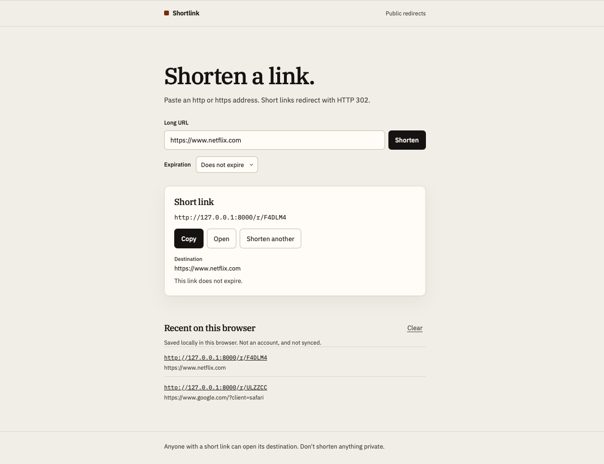
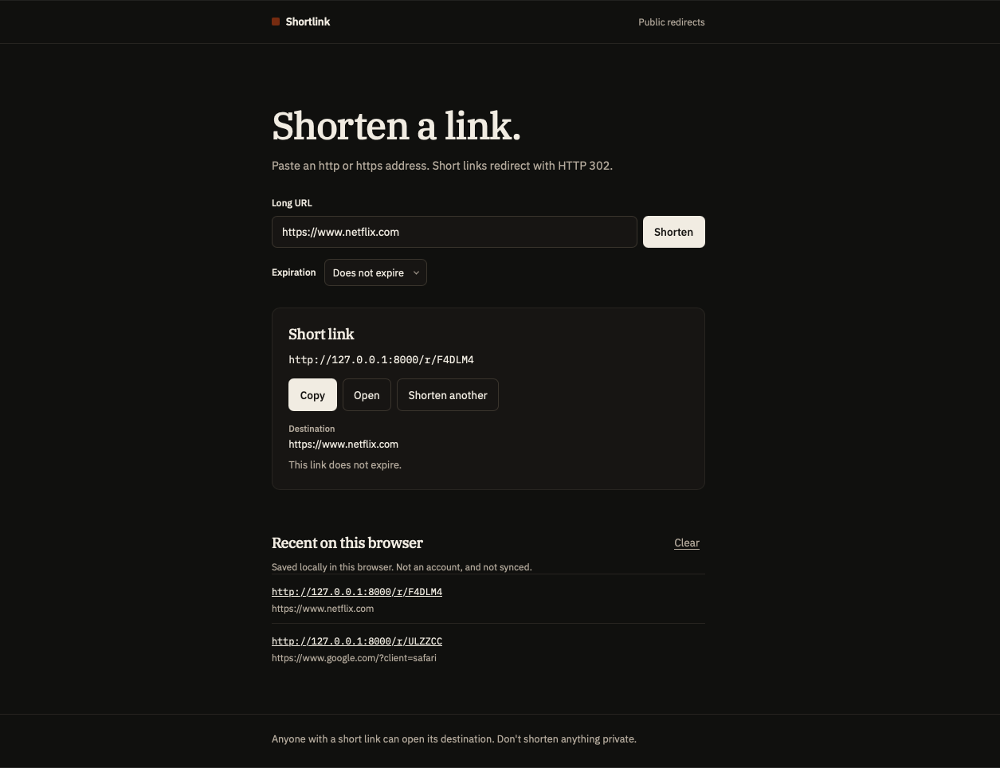
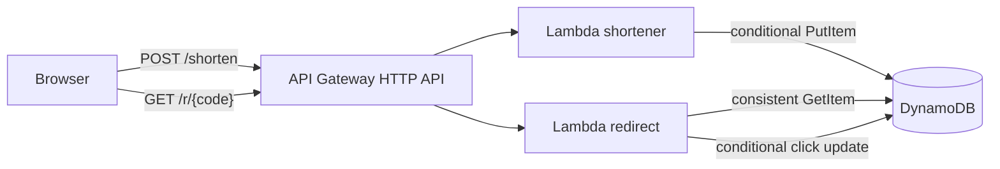

# Shortlink

A small public URL shortener. You submit an `http` or `https` URL and get a short link. Opening that link returns HTTP 302 to the URL you stored.

The interesting part is the request path: an HTTP API in front of two Lambda functions, a conditional DynamoDB write so codes are not overwritten, and a redirect that is an actual redirect. The same Python handlers run in Lambda and in a local server, so the tests and the UI do not need an AWS account.

<table>
  <tr>
    <td></td>
    <td></td>
  </tr>
</table>

There is no public deployment checked into this repository. After `terraform apply`, the API URL is the `http_api_url` output.

## Features

- `POST /shorten` stores a mapping and returns the code, the absolute short URL, and the normalized destination.
- `GET /r/{code}` responds with `302` and a `Location` header. Unknown codes are `404`. Malformed codes are `400`. Expired codes are `410`.
- Codes are 6 characters from `A-Z` and `0-9`, generated with `secrets`. `PutItem` refuses to overwrite an existing code.
- Optional expiration from 1 to 365 days. The redirect checks the timestamp itself because DynamoDB TTL deletion is delayed.
- Click counts use an atomic `ADD` and only update a row that still exists. A failed count does not fail the redirect.
- The page validates input, shows the full short URL, copies it only after the clipboard API succeeds, and keeps a short history in this browser.

The click counter is not exposed in the UI. There is no read API for it, and the page does not invent charts.

## Stack

| Piece | Choice |
| --- | --- |
| API | API Gateway HTTP API, payload format 2.0 |
| Compute | Lambda, Python 3.11, arm64, one zip for both handlers |
| Data | DynamoDB on-demand, partition key `short_code` |
| Page | HTML, CSS, and a small JavaScript module |
| Infra | Terraform |
| CI | GitHub Actions. Deploy is manual and uses OIDC |

HTTP API is enough: two routes, Lambda proxy integration, CORS, and stage throttles. A REST API would add usage plans this design does not use, at a higher price. DynamoDB fits a point read and a point write. The page is one form, so it stays static instead of taking on a frontend framework.

## Architecture



Terraform creates those resources. The deploy workflow runs Terraform. CloudWatch holds the function logs. Neither sits on the request path.

## Design choices

**Lambda and HTTP API.** Each request is short and independent. There is no idle fleet. The tradeoff is cold starts and a 5 second timeout, which is enough for a DynamoDB call and too small for any design that fetched the destination.

**One partition key.** Every operation is "this code". A sort key or a GSI would support listing links or finding an existing code for a URL. The product does not do those things, so the table does not either. Repeating a URL creates a new code on purpose.

**Collisions.** The code space is 36^6, about 2.18 billion. `PutItem` with `attribute_not_exists(short_code)` is what prevents two URLs from sharing a code, including under concurrent creates. The generator retries up to five times and then returns 503. Collisions are unlikely at a small table and are not impossible.

**302.** Clients follow it. `Cache-Control: no-store` is set so a cache does not skip the function. 301 would be a worse default here because caches may store it. The body is plain text. The destination is not written into HTML.

**Clicks.** The update is conditional on the item still existing, so a deleted code is not recreated as a partial row. If the update fails, the visitor is still redirected. The counter can undercount. It is not treated as an exact metric.

**Errors.** Callers get a fixed message and a stable `code`. DynamoDB messages stay in logs, and logs do not record the destination URL.

**Limits.** This will scale with DynamoDB on-demand and Lambda concurrency until a single popular code makes one partition hot, or until the account's Lambda concurrency or the stage throttle is hit. Those limits are not the same thing as a load test. None has been run.

## API

`POST /shorten`

```json
{ "long_url": "https://example.com/article", "expires_in_days": 7 }
```

`expires_in_days` is optional. When present it is an integer from 1 to 365.

`201`

```json
{
  "short_code": "ABC123",
  "short_url": "https://abc123.execute-api.us-east-1.amazonaws.com/r/ABC123",
  "long_url": "https://example.com/article",
  "created_at": "2026-10-18T06:00:00Z",
  "expires_at": "2026-10-25T06:00:00Z"
}
```

`short_url` uses `PUBLIC_BASE_URL` when that environment variable is set. Otherwise it is built from the API Gateway domain. `long_url` is the normalized form: trimmed, scheme and host lowercased, internationalized hosts in punycode.

| Status | Meaning |
| --- | --- |
| 201 | Created |
| 400 | `invalid_json`, `invalid_url`, or `invalid_expiration` |
| 405 | Not POST |
| 429 | API Gateway throttled the route. The body is not the JSON error schema |
| 503 | Could not allocate a code, or DynamoDB rejected the write |

`GET /r/{code}`

| Status | Body |
| --- | --- |
| 302 | `Location` is the stored URL. Body is `Redirecting` |
| 400 | The path is not 6 characters from `A-Z` and `0-9`. Lowercase input is accepted and folded to uppercase |
| 404 | No such code |
| 410 | The code exists and `expires_at` has passed |
| 503 | DynamoDB could not be read |

Accepted URLs are `http` and `https`, at most 2048 characters, with a real host. Userinfo, control characters, single-label names, and non-global IP addresses are rejected. The service does not fetch or resolve the destination. A public hostname can still point somewhere unpleasant when a browser follows the redirect. That is what a public shortener does.

## Local development

These commands do not need AWS credentials.

```bash
python3 -m venv .venv
source .venv/bin/activate
pip install -r requirements-dev.txt
make test
scripts/up
```

Open `http://127.0.0.1:8000`. `scripts/down` stops that process. `make dev` runs the same server in the foreground. The dev server uses the Lambda handlers and an in-memory table. Restarting it drops every link. `frontWeb/config.js` leaves `apiBaseUrl` empty so the page calls the same origin. Set that value to an API Gateway URL only when the page is hosted apart from the API.

`make lint` runs Ruff. `make validate` runs `terraform fmt` and `terraform validate` if Terraform is installed.

## Tests

`make test` runs pytest and the Node tests.

Pytest covers URL policy, code generation, collision retries, conditional writes, strongly consistent reads, click updates that refuse to recreate a missing item, HTTP status codes, base64 bodies, and the local server. The DynamoDB tests use a stub table. They check the condition expressions and that provider error text does not leave the process.

The Node tests cover client-side validation, interpretation of API responses, and the browser-local history cap. They do not open a browser. The UI was also exercised against the dev server: empty input, a loopback URL, a successful create, and a `curl` of the new code confirming `302`.

## AWS deployment

You need Terraform 1.10 or newer, an AWS account, and a decision about state. Fresh checkouts validate with a disabled backend so `terraform init` does not migrate anything.

```bash
terraform -chdir=infra init -backend=false
terraform -chdir=infra validate
```

To apply: bootstrap an S3 state bucket, configure `backend.hcl`, read the plan, then apply. The default table name is `URLShortner`, matching the original resource so an existing table is updated rather than replaced. Confirm that in the plan. Replacing the table deletes the mappings.

GitHub Actions CI (`.github/workflows/ci.yml`) runs tests and `terraform validate` without cloud credentials. Deploy (`.github/workflows/deploy.yml`) is started by hand on `main`, assumes a role with OIDC, and will not run from a pull request. Required settings are the `AWS_DEPLOY_ROLE_ARN` secret, the `AWS_REGION` and `TF_STATE_BUCKET` variables, and a GitHub Environment named `production`.

Runtime IAM is separate for each function: the shortener can `PutItem`, the redirect function can `GetItem` and `UpdateItem`, and each can write only to its own log group. API Gateway may invoke each function only on its own route.

Default throttles, shared by all callers, are 5 requests/second for creates and 20 for redirects. Raise them with Terraform variables if a real link needs more. They are a cost ceiling, not a per-visitor quota.

## Security

- Public codes are drawn from `secrets`. Possession of a code is the only check. Do not shorten anything private.
- Destination URLs are constrained as above and are not fetched server-side.
- Responses use `nosniff` and `no-store`. Redirects also set a referrer policy and HSTS. `X-XSS-Protection` is not set.
- Create errors are JSON. Redirect errors are plain text. Neither includes a stack trace or a DynamoDB message.
- Logs omit destination URLs.
- Deploy uses short-lived OIDC credentials. The workflow does not contain an AWS access key.

Stage throttles do not stop a distributed set of clients from sharing the budget. There is no WAF and no account system.

## Observability

Each function logs JSON to its CloudWatch log group: event name, short code, request id, and on failure the exception type. Log groups keep 14 days. Lambda's built-in error and duration metrics are available in CloudWatch. Optional alarms for the Lambda `Errors` metric are behind `enable_alarms` because alarms cost money and need somewhere to send a notification. There are no custom metrics and no request-latency SLO in this repo.

## Cost

The bill follows request volume: API Gateway HTTP API, Lambda duration, and DynamoDB on-demand read and write units. Point-in-time recovery stores backups and has its own charge. Log retention is capped at 14 days. The stage throttles are the control that stops a loop from running the bill up without a limit. No monthly estimate is stated here because it depends on traffic and on current AWS prices.

## Limitations

- One hot short code is one DynamoDB partition.
- Click counts can miss updates and have no public read API.
- Throttles are global to the stage, not per IP.
- TTL does not delete rows at the exact expiration instant. Reads do not rely on it.
- There is no instant Lambda rollback alias.
- The local server forgets data when it stops.
- No load test has been run. "Scales with Lambda" is a description of the architecture, not a measured throughput.

## Layout

```text
backend/urlshortener   shared validation, storage, and HTTP mapping
backend/handlers        Lambda entry points
backend/devserver.py    local server
frontWeb                static page
tests                   pytest and Node tests
infra                   Terraform application stack
infra/bootstrap         optional S3 state bucket
.github/workflows       CI and manual deploy
```
